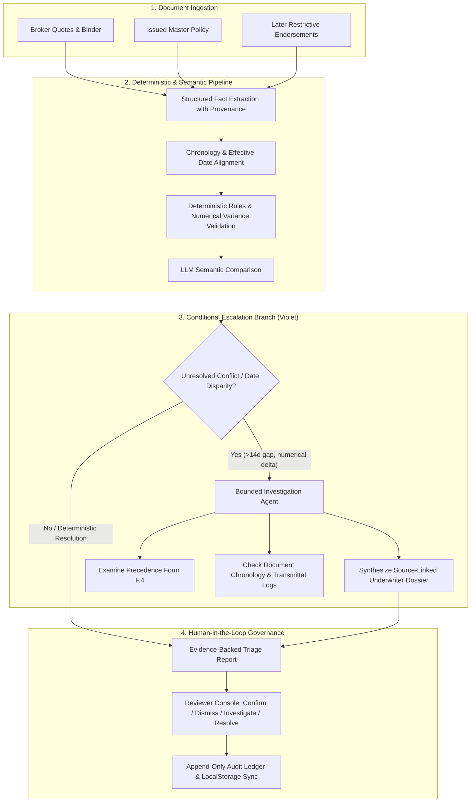

# Coverage Truth Layer (CTL)

> **Catch coverage contradictions before they become denied claims.**

[](https://flarre.ai)
[](#)
[](#)

---

## 1. Project Identity & Overview

**Coverage Truth Layer** is an AI-powered insurance document reconciliation and evidence-traceability layer that compares broker quotes and communications against issued policies and endorsements, flags potential contradictions, links findings to source evidence, considers document versions and effective dates, and routes findings to human reviewers.

- **Product:** Coverage Truth Layer
- **Tagline:** Catch coverage contradictions before they become denied claims.
- **Submitted by:** Mekala Abhilash
- **Institution:** Chaitanya Bharathi Institute of Technology (CBIT)
- **Challenge:** Flarre AI Innovation Challenge 2026 (Individual Submission)

---

## 2. Core Idea & Architecture

### The Governing Principle
> **“Pipeline first. Agent when needed. Human judgment for the final decision.”**



### The Three-Part Insurance Triad
1. **PROMISED (Active Scope):** Broker indications, quotes, proposals, and pre-binding representations.
2. **DOCUMENTED (Active Scope):** Carrier master policies, ISO forms, and subsequent restrictive endorsements.
3. **PAID (Future Scope):** Post-loss claims handling, reservation of rights, and settlement calculations.

---

## 3. Technology Stack

- **Framework:** React 18 + TypeScript + Vite
- **Styling:** Tailwind CSS (Enterprise dark palette: Deep Navy `#070A12`, Electric Cyan `#00E5FF`, Restrained Violet `#A855F7`, Emerald `#10B981`)
- **Animations:** Framer Motion & Canvas Confetti
- **Icons:** Lucide React
- **Persistence:** LocalStorage for human-review dispositions and immutable audit events
- **Zero API Keys Required:** Comes preloaded with verified fictional commercial property documents (Apex Global Logistics LLC)

---

## 4. Getting Started

### Prerequisites
- Node.js `v18+` or `v20+` (Tested on Node `v22.18.0`)
- npm `v9+` or `v11+`

### Installation
```bash
# Clone or navigate to the project directory
cd "Flarre-Hackathon"

# Install dependencies
npm install
```

### Development Server
```bash
npm run dev
```
Open [http://localhost:5173](http://localhost:5173) in your browser.

### Production Build & Preview
```bash
# Build production bundle
npm run build

# Preview production build locally
npm run preview
```

---

## 5. What Is Genuinely Functional vs. Simulated

| Feature | Status | Implementation Details |
|---|---|---|
| **Document Comparison & Side-by-Side Wording Diff** | **Fully Functional** | Live highlighted quote vs endorsement diff with line numbers and metadata. |
| **Evidence Traceability Inspector** | **Fully Functional** | Cryptographic hashes, exact paragraph citations, and version provenance. |
| **Human-Review Triage Console** | **Fully Functional** | Working action buttons (`Confirm Gap`, `Dismiss`, `Request Audit`, `Mark Resolved`) and notes editor. |
| **Audit Ledger & Persistence** | **Fully Functional** | Audit events and note changes persist in `localStorage` across page reloads. |
| **8-Step Reconciliation Simulation** | **Interactive Simulation** | Real-time animated stepper with live terminal execution logs and celebratory output. |
| **Document Upload Area** | **Functional UI Demo** | Drag-and-drop validation for PDF/DOCX/TXT with progress simulation. Explicitly marked as demo for local session. |
| **AI LLM & Agent Backend** | **Structured Simulation** | Demonstrates the exact agentic DAG, bounded tool sequence, and input/output contracts with realistic commercial property data. |

---

## 6. Enterprise Pilot Evaluation Framework

A future production deployment should measure:
1. **Detection Precision & Recall:** Benchmark against senior coverage counsel gold-standard audits.
2. **False Positive Containment:** Target `< 5%` false alarm rate on standard ISO wording variations.
3. **Evidence Link Accuracy:** 100% exact page and paragraph citation fidelity with zero hallucinated anchors.
4. **Underwriter Time-to-Bind:** 70% reduction in manual cross-referencing hours.
5. **Human Reviewer Agreement:** Concordance between underwriters on contract remediation actions.
6. **Audit Completeness:** Full immutable logging for reinsurance and E&O protection.

---

## 7. Deployment Instructions

### Vercel Deployment (One-Click / CLI)
The repository includes [`vercel.json`](./vercel.json) pre-configured with SPA route rewrites.

```bash
# Deploy with Vercel CLI
npx vercel --prod
```

### Netlify / Cloudflare Pages / Static Hosting
1. Build the production output: `npm run build`
2. Publish directory: `dist/`
3. Fallback rewrite: `/index.html` (all routes redirect to `index.html`).

---

## 8. Credits & Disclaimer

- **Author:** Mekala Abhilash
- **Institution:** Chaitanya Bharathi Institute of Technology (CBIT)
- **Challenge:** Flarre AI Innovation Challenge 2026
- **Disclaimer:** *Fictional illustration for Flarre AI Innovation Challenge 2026. This data represents simulated insurance documents and does not constitute a legal coverage determination or actual policy binding.*
